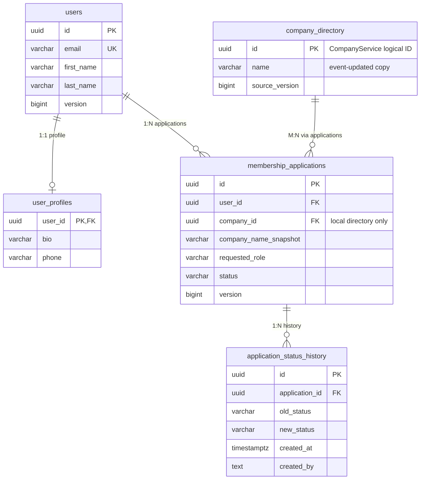
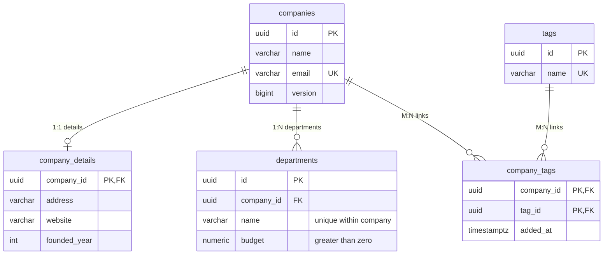
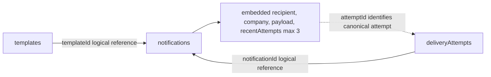

# ERD лабораторної №1

Діаграми відповідають DDL у `users/01-schema.sql` та `companies/01-schema.sql`.
`o|` означає необов'язковий залежний запис (не більше одного). Аудитні колонки
скорочено; повний перелік і обмеження містяться в SQL.

## Проєкт №1: користувачі та заявки

Зв'язок M:N між користувачами й локальним довідником компаній реалізовано через
`membership_applications`, що має власні поля ролі, статусу й знімка назви.
`company_directory.id` логічно відповідає `companies.id` в іншій БД; FK між ними немає.

## Проєкт №2: компанії

## MongoDB: агрегат сповіщення

Повна історія доставлення зростає в `deliveryAttempts`. Короткий список останніх
спроб вбудовано в сповіщення для читання без додаткового запиту: це гібридна модель.
